# 预训练模型

预训练语言模型几乎都构建在 Transformer 架构之上。相较于传统的循环神经网络，Transformer具有以下优势：

- 并行计算效率高，适合大规模训练；
- 上下文建模能力强，可捕捉长距离依赖；
- 结构通用灵活，可适配多种任务类型；
- 易于扩展与迁移，支持参数堆叠与多任务学习。

## 1、预训练模型分类

ransformer 成为预训练模型的主流基础架构。根据 Transformer 的使用方式不同，预训练模型大致可分为以下三类：

- 解码器（Decoder-only）模型  GPT
- 编码器（Encoder-only）模型 BERT
- 编码器-解码器（Encoder-Decoder）模型 T5

## 2、GPT

GPT（Generative Pre-trained Transformer）是第一个系统性提出“预训练 + 微调”范式的语言模型。

其核心思想是通过大规模无监督语料进行***\*生成式语言建模\****预训练，即训练模型根据左侧上下文预测下一个词，从而让模型学习自然语言的通用语法、语义和上下文依赖能力。完成预训练后，再通过微调适应具体的下游任务。

GPT首次展示了生成式语言模型在自然语言理解任务中的广泛迁移能力，为后续 GPT 系列及整个预训练语言模型的发展奠定了基础。

GPT架构如下：

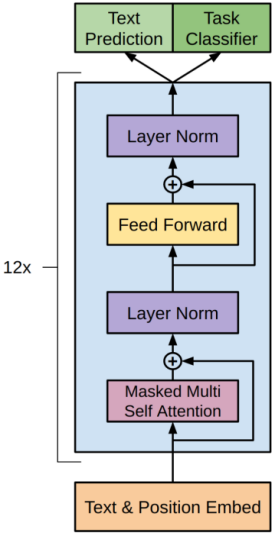

各部分细节如下：

（1) 输入嵌入层

与原始Transformer一样，每个输入 token 的表示也由两部分组成：

- Text Embedding：将词或子词映射为向量；

- Position Embedding：提供词在序列中的位置信息。

GPT不同于原始Transformer的一点在于：位置编码采用的是可学习的位置嵌入（learnable positional embedding）。这意味着每个位置对应一个可训练的向量，模型可以在训练过程中自动优化这些向量，而非使用不可训练的三角函数编码（如正弦/余弦函数）。

每个token的最终表示是词嵌入与位置嵌入的向量和，向量维度为 768。

（2）解码器

解码器部分由12个结构相同的解码器层堆叠而成，每个解码器层只包含如下两个子层：

- 掩码多头自注意力（12头）

- 前馈网络

（3）输出层

根据任务不同，GPT模型输出可以接入不同任务头

- ***\*Text Prediction（文本预测）\****

用于下一个词的生成，输出是词表大小的概率分布，经过Softmax获得，预训练阶段使用的便是该任务头。

- ***\*Task Classifier（任务分类器）\****

该任务头多用于模型微调阶段，以适配具体的下游任务。通过提取特定位置的表示（如最后一个token）对整个输入文本进行分类（如情感分析、话题识别等）。

### gpt预训练方法

GPT 的预训练阶段采用生成式语言建模（Generative Language Modeling）作为训练目标，在大规模无监督文本上进行自监督学习。具体而言，模型的任务是基于已观察到的前文上下文，预测当前词的位置应出现的词，从而学习自然语言的统计规律与上下文依赖关系。这种自回归语言建模方式不依赖人工标注，训练样本可以直接从原始文本中自动构建，极大地降低了构建数据的成本。

GPT 使用 Transformer 架构，具备全局自注意力机制，能够有效建模长距离依赖信息。同时，Transformer 的并行计算特性使得模型能够高效处理长文本序列，相较于传统的 RNN 架构，训练效率显著提升，也使得在大规模语料上进行预训练成为可能。

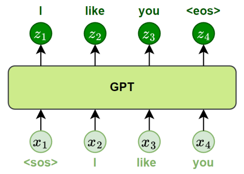

### gpt微调方法

GPT的微调阶段是在完成无监督语言建模预训练之后，使用有监督的任务数据对模型进行进一步训练，使其适应具体的下游任务。微调的核心思路是：在保留预训练语言建模能力的基础上，利用标注数据对整个模型进行端到端优化，从而实现知识迁移。

具体实践中，GPT采用了如下两个关键措施：

- 添加任务输出层

在预训练模型顶部引入一个线性输出层（Linear Head），用于将 GPT 的隐藏状态映射为下游任务所需的标签或输出。

- 统一输入格式设计

GPT 作为自回归语言模型，其输入需为连续的文本序列。因此，在微调过程中需将各种下游任务转化为统一的文本输入格式。

下图展示了不同任务的微调逻辑：

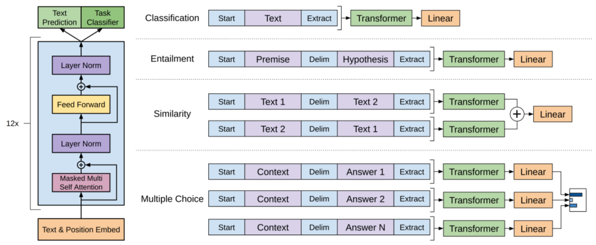

## 3、GPTvsBERT

## ✅ 联系

1. 两者**都基于 Transformer**，都使用多头自注意力、残差连接、层归一化、前馈网络；
2. 都是**自监督预训练**，在海量无标注文本上先预训练，再适配下游任务；
3. 2018 年同期提出，奠定预训练范式。

> 核心差异：**BERT 取 Transformer 的 Encoder（双向理解）；GPT 取 Transformer 的 Decoder（单向自回归生成，去掉交叉注意力）**

## ✅ 核心区别

表格

| 维度       | BERT（Encoder-only）                                         | GPT（Decoder-only）                                          |
| ---------- | ------------------------------------------------------------ | ------------------------------------------------------------ |
| 注意力     | **双向自注意力**，每个 token 可以同时看到左边、右边全部上下文 | **因果掩码单向注意力**，只能看到左侧上文，看不到未来 token   |
| 预训练目标 | **MLM 掩码语言模型（完形填空）**：随机 mask15% token，利用上下文预测被 mask 词；附带 NSP 下一句预测 | **CLM 因果语言模型**：给定上文，预测下一个 token（Next Token Prediction） |
| 模型类型   | **判别 / 表征模型（NLU 自然语言理解）**                      | **生成模型（NLG 自然语言生成）**                             |
| 输出       | 输出每个 token 的语义向量，[CLS] 向量做分类                  | 输出下一个 token 概率分布，逐 token 自回归续写               |
| 下游使用   | 传统范式：**必须针对每个任务微调**                           | 支持 zero-shot/few-shot 提示词，上下文学习，也可以 SFT 微调  |

## ✅ 各自优劣

### BERT（Encoder-only）

**优点**

1. 双向上下文，**文本理解能力强**，分类、实体抽取、语义匹配、RAG 重排（Reranker）效果好；
2. 推理时一次性全部 token 并行计算，**短文本推理速度快**；
3. 训练目标简单稳定，小参数量下效果好。

**缺点**

1. **天生不擅长生成**，预训练任务是 “填空”，不是续写，很难做对话、长文本写作；
2. 几乎没有**上下文学习（In-Context Learning）**能力，很难靠 prompt 直接做新任务，每个任务大多需要单独微调 + 标注数据；
3. MLM 训练只对 15% mask 位置计算损失，**监督信号利用率低**；
4. 预训练窗口固定（原版 BERT 仅 512token），长文本能力弱。

### GPT（Decoder-only）

**优点**

1. 自回归 Next-Token 预测，**天然支持文本续写、对话、代码、推理、Agent 工具调用**；
2. 强大的**上下文学习 ICL**，给几个示例就可以做新任务，不需要大量标注微调；
3. 训练和推理范式统一：训练是从左往右预测下一个 token；推理也是从左往右生成；
4. 可以很好支持**KV Cache**，长上下文推理工程优化成熟；
5. Scaling Law（缩放定律）表现好：参数量、数据量越大，能力稳定提升，涌现推理能力。

**缺点**

1. 逐 token 自回归生成，**长生成推理慢**；
2. 单向注意力，单纯做文本分类、语义匹配任务，同等参数量下，理解精度通常弱于 BERT；
3. 训练成本极高，大模型训练算力消耗巨大。

## ✅ 为什么 GPT（Decoder-only）更适合现代大模型

> 面试核心回答，分 4 点：

1. **任务范式统一，适配通用助手** 现代大模型目标是通用任务：问答、写作、代码、推理、Agent 工具调用。全部任务都可以统一成「提示词 + 续写回答」的序列格式。 BERT 的 MLM 填空目标，只能做理解类任务，无法自然输出长文本回答。
2. **上下文学习（ICL）能力，大模型涌现能力** Decoder-only 的自回归预训练天然学习 “根据前文示例完成任务”，具备 few-shot/zero-shot 能力； BERT 没有 ICL，新任务一般需要标注数据微调，无法直接用 prompt 做任务。
3. **Scaling Law 缩放特性好** OpenAI 发现：Decoder-only 架构在增大参数量、数据、算力时，loss 平滑下降，能力稳定涌现； Encoder-only（BERT）放大到超大参数量，收益增长不明显，很难涌现复杂推理、逻辑能力。
4. **工程与对齐链路高度适配**

- 推理侧：自回归解码天然支持 KV Cache，vLLM/PagedAttention 等整套加速生态成熟；
- 对齐侧：SFT、DPO、GRPO、RLHF 全部都是基于 “输入 prompt，生成输出” 的生成范式，直接优化模型输出文本，非常方便做人类偏好对齐。

> 一句话总结面试背诵版： BERT 是 Encoder-only 双向理解模型，擅长分类、检索重排；GPT 是 Decoder-only 单向自回归生成模型。现代大模型追求通用对话、推理、上下文学习，并且 SFT/RLHF 对齐、KV Cache 推理优化都适配自回归范式，同时缩放定律表现更好，所以主流大模型选择 GPT 式 Decoder-only 架构。**但 BERT 并没有被淘汰，现在常作为 RAG 的 Embedding、Reranker 等理解组件嵌入到大模型系统中**。

------

### 精简口述背诵版

BERT 是 Encoder-only 双向理解模型，擅长分类、检索重排；GPT 是 Decoder-only 单向自回归生成模型。现代大模型追求通用对话、推理、上下文学习，并且 SFT/RLHF 对齐、KV Cache 推理优化都适配自回归范式，同时缩放定律表现更好，所以主流大模型选择 GPT 式 Decoder-only 架构。但 BERT 并没有被淘汰，现在常作为 RAG 的 Embedding、Reranker 等理解组件嵌入到大模型系统中。

# 大模型演进

## 1.LLM

> 现代llm在原来transformer的基础上改进方向总结如下

### 1.1 位置编码

正余弦位置编码（Sinusoidal Positional Encoding）是原始Transformer 中采用的位置编码方式，它通过一组预定义的正弦与余弦函数为每个序列位置生成唯一向量：
$$
PE(pos,2i) = sin(\frac{pos}{10000^\frac{2i}{d}})
$$

$$
PE(pos,2i+1) = cos(\frac{pos}{10000^\frac{2i}{d}})
$$

其中：

- pos：Token 的绝对位置

- i：维度索引

- d：总维度

正余弦位置编码具有以下特点：

- 无需训练
- 可外推
- 隐含相对位置信息

尽管正余弦位置编码具有良好的数学结构，其向量间的内积可直接反映相对位置关系，但在实际的 Transformer 注意力计算中，这种优势并不能完全有效发挥。

**可学习位置编码**

可学习位置编码（Learned Positional Embedding）是另一种常见的位置编码方式，曾广泛应用于早期的Transformer预训练模型（Bert，GPT-1/2等）中。在这种方法中，模型为序列中的每个位置分配一个独立的可训练向量，这些向量在训练过程中与模型的其他参数一同更新，使模型能够从实际任务数据中自动学习位置表示。

可学习位置编码具有以下特点：

- 灵活性高
- 训练方式简单

可学习位置编码只在训练过的位置范围内定义，超出最大序列长度的位置没有对应的嵌入，导致模型无法在推理阶段处理更长的输入序列。

位置向量数量与最大序列长度成正比，当需要支持长上下文时，参数开销迅速增大。

> 解决上述问题使用旋转位置编码

旋转位置编码（Rotary Position Embedding，RoPE）由国内研究者苏剑林提出。与传统将位置编码与词向量相加的方式不同，RoPE 直接作用于 q 和 k 向量本身，使注意力计算能够更好地体现 token 之间的相对位置关系。在实践中，RoPE 表现稳定，尤其适用于长序列建模，因此已成为当前 LLM 普遍采用的位置编码方案。

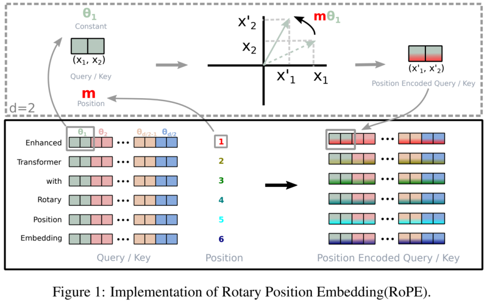

其特点如下：

- 显式编码相对位置信息
- 零参数且训练稳定
- 强长度外推能力

### 1.2Attention

注意力机制（Attention）是 Transformer 中最核心的模块，用于刻画序列中不同位置之间的依赖关系，决定模型在生成下一个 token 时应如何利用上下文。其能力直接影响模型的语义理解、长程依赖建模与文本生成质量。

随着模型规模不断扩大、推理序列越来越长，传统的多头注意力的问题逐渐暴露出来。为了解决这些问题，业界提出了一系列改进结构，在保持模型能力的同时显著提升了推理效率。

> KVcatch的使用

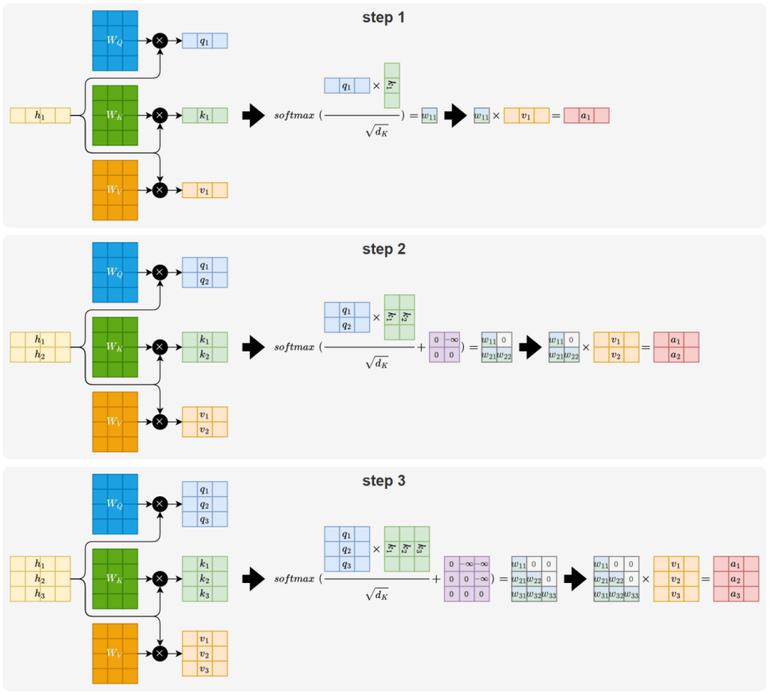

为了避免这种重复计算，模型都会在推理阶段将历史 token 的 Key 和 Value 缓存下来，供后续步骤直接使用。这一机制就是 KV Cache。通过缓存 K/V，模型在生成下一个 token 时只需计算当前 token 的 Q、K、V，再与缓存的 K/V 做一次注意力匹配即可，大幅减少了不必要的计算量，如下图所示：

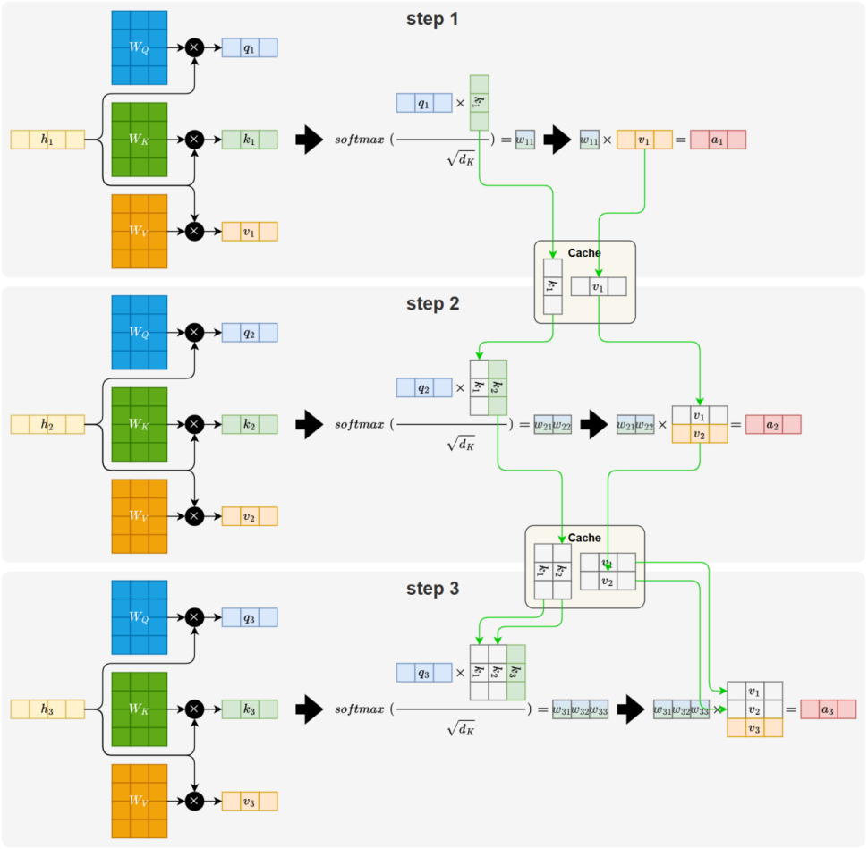

KV Cache 的引入，虽然减少了重复计算，但需要持续保存过往 token 的 Key 和 Value。随着序列变长、模型层数增加，缓存量本身就会不断累积。并且在多头注意力（MHA）中，每个注意力头都会独立生成并存储一组 Key 和 Value，使得缓存规模在原有基础上进一步放大。这也构成了 MHA 在大模型推理中的主要问题。

MQA（Multi-Query Attention，多查询注意力）是一种优化注意力机制的方案，旨在减少推理阶段 KV Cache 的存储与内存带宽开销。由Google于 2019 年 11 月发表在论文《[Fast Transformer Decoding: One Write-Head is All You Need](https://arxiv.org/pdf/1911.02150)》。

MQA 的核心思想是让多个注意力头共享同一套 Key 和 Value，而不是像传统 MHA 那样为每个头分别维护独立的 K/V。

这种共享方式大幅减少了需要缓存和读取的 K/V 张量量级，显著降低存储需求与内存带宽压力，从而大幅提升了推理速度。

但这种共享机制会略微削弱注意力头的表达能力，使其精度略逊于传统 MHA，但整体损失非常小。

GQA（Group-Query Attention，分组查询注意力）是在 MQA 基础上的进一步改进方案，由 Google 在论文 《[GQA: Training Generalized Multi-Query Transformer Layers](https://arxiv.org/pdf/2305.13245)》中提出。该方法旨在在提升推理效率的同时，弥补 MQA 由于所有注意力头共享同一套 K/V 而造成的表达能力下降问题

GQA 的核心思想是：***\*将注意力头划分为多个组（Group），每组内部的多个 Query 共享同一套 Key 和 Value，而不同组之间则使用独立的 K/V\****

### 1.3 **Feed Forward Network**

前馈网络（FFN）是 Transformer Block 中继注意力之后的第二大核心组件，用于对 token 表示进行独立的非线性变换。其典型的“升维 → 激活 → 降维”结构，使模型能够在每个位置上学习高维特征，是 Transformer 表达能力的重要来源。

FFN 的演进主要集中在***\*激活函数\****和***\*整体结构形式\****两个方向。

> 激活函数

Relu

ReLU（Rectified Linear Unit）是深度学习中最早广泛应用的激活函数之一，其定义非常简单：

其函数曲线如下图所示：

 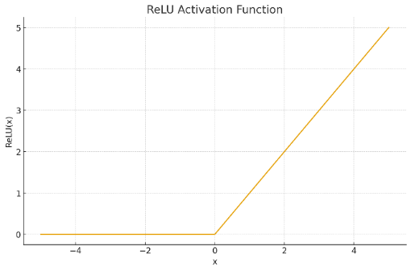

ReLU 在正区间保持恒定梯度，使梯度能够高效传播，大大缓解了早期网络中的梯度消失问题，因而在浅层或中等规模神经网络中表现优异。然而，ReLU 对负区间进行“硬截断”，会导致梯度完全为零，从而引发“死亡神经元”现象，即神经元在训练过程中一旦进入负区间可能永久失活；此外，其非线性较弱，在深层 Transformer 中无法提供足够的梯度平滑性与稳定性，容易造成训练不稳定。

随着模型深度和规模的大幅提升，ReLU 已难以满足大模型的稳定性要求，因此在现代大型语言模型中已经基本退出主流。

GELU

GELU（Gaussian Error Linear Unit）是早期Transformer预训练模型（例如Bert、GPT-2/3）中曾广泛采用的平滑非线性激活函数。

GELU的核心思想是：不再进行硬性截断，而是通过一种 ***\*随输入大小平滑变化的缩放系数\**** 来柔性控制激活强度，使得输入在负区间、中间区间、正区间分别呈现自然的衰减、过渡与放大。

其数学定义为：
$$
GELU(x) = x·Φ(x)
$$

其中 Φ(x)表示标准正态分布的累积分布函数。

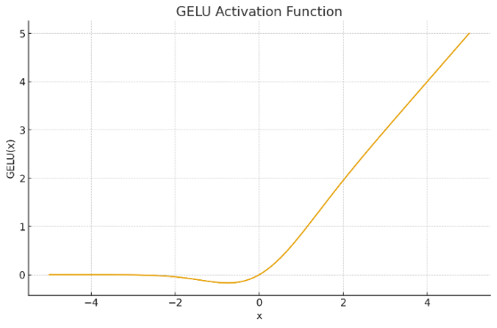

SILU

SiLU（Sigmoid Linear Unit）也是一种连续可导的激活函数，其基本思想是使用 sigmoid 函数对线性输入进行加权，从而得到一种柔和的非线性变换。

其数学定义如下：
$$
SILU(x) = x·σ(x)
$$
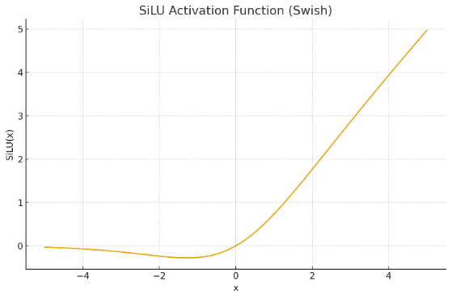

Swish 可视为 SiLU 的一般化形式，其数学定义为：
$$
Swish(x) = x·σ(βx)
$$
其中 β可以是固定或可学习参数。当β=1时，Swish 与 SiLU 完全等价。尽管原论文提出让 β可学习，但实际收益有限，并可能带来训练不稳定性，因此主流实现通常将 β固定为 1。

基于这一等价关系，在工程实践中 Swish 与 SiLU 往往混用，不作严格区分。

> 现代大模型使用最多的激活方法是gelu的变体

GLU（Gated Linear Unit）及其一系列变体是当前大型语言模型（LLM）中最常用的 FFN 激活结构。与传统 ReLU、GELU 等单路激活不同，GLU 类结构采用 “主分支 × 门控分支” 的双分支设计，通过引入门控机制，使模型能够对信息流进行更加细致的筛选与调控。如下图所示：

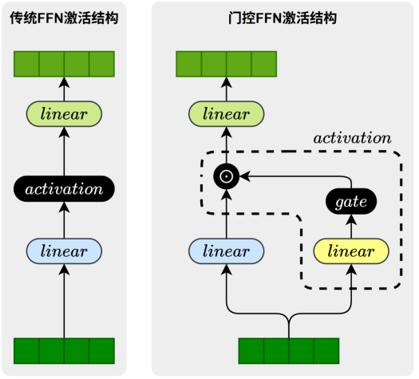

门控结构的关键区别在于 ***\*门控分支所采用\*******\*的门控\*******\*函数\****。不同的函数会导致门控行为、梯度特性和最终模型性能的差异，因此形成了多种 GLU 变体。常见的门控结构包括

- GLU：使用 Sigmoid 作为门控函数

- GEGLU：使用GELU作为门控函数

- SwiGLU：使用SiLU作为门控函数

在众多变体中，SwiGLU在性能与训练稳定性方面表现最优，因此成为当前主流 LLM（LLaMA、Qwen、DeepSeek 等）的默认门控结构。

Moe

MoE（Mixture of Experts，混合专家模型）是在传统 FeedForward 模块基础上的一种结构扩展。其核心思想是：使用多个并行的 FeedForward 专家替代单一的 FeedForward 层，并通过 Router（路由器）根据输入 Token 的特征选择其中少量最合适的专家参与计算。这样一来，不同类型的输入能够由擅长处理该类模式的专家负责，从而显著增强模型的表达能力与适应性。MoE 已成为当前主流大语言模型（LLM）中广泛采用的、用于提升性能与效率的关键结构之一。

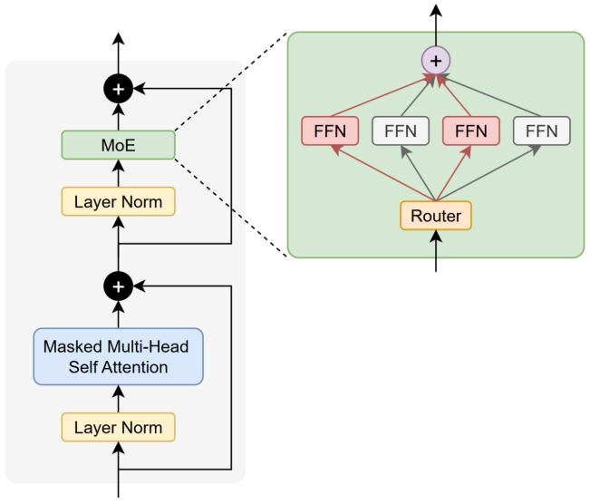

