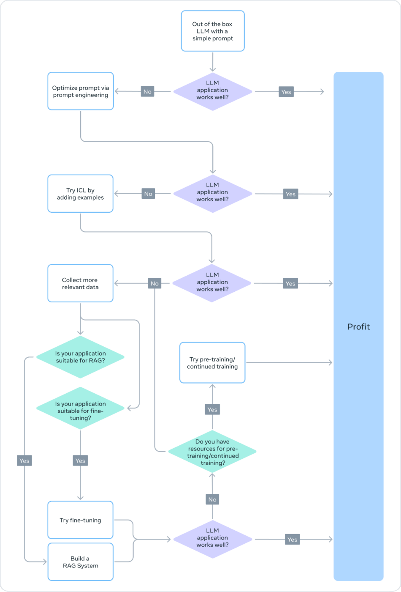

# 微调

## 1、微调概述

微调（Fine-tuning）是指在已有模型的基础上，使用特定数据继续训练，使模型更好地适应目标任务。根据训练数据和训练目标的不同，大模型微调主要包括监督微调和偏好对齐。本篇主要讨论监督微调（Supervised Fine-tuning，SFT），即使用高质量的输入—输出示范，让模型学习在特定输入下生成符合要求的回答。

大语言模型经过大规模预训练后，已经具备问答、总结、翻译和信息抽取等通用能力，但这些能力不一定能够直接满足具体应用需求。通过监督微调，模型可以学习目标任务中的输入—输出关系、执行步骤和表达规范，从而减少输出格式不稳定、专业术语不统一和任务步骤遗漏等问题，使输出更加符合应用要求。

大预言模型出问题时采用上面方法来解决？

